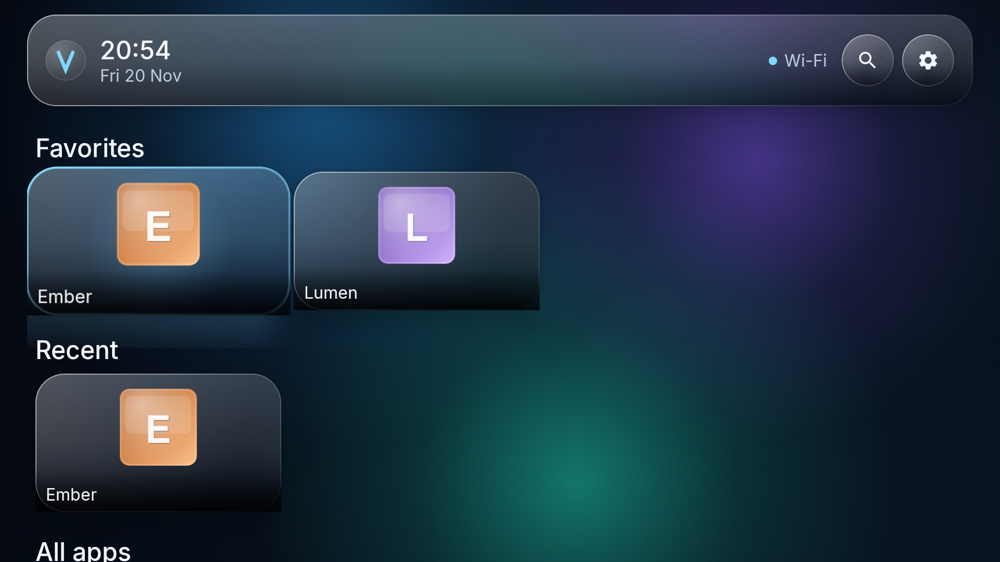
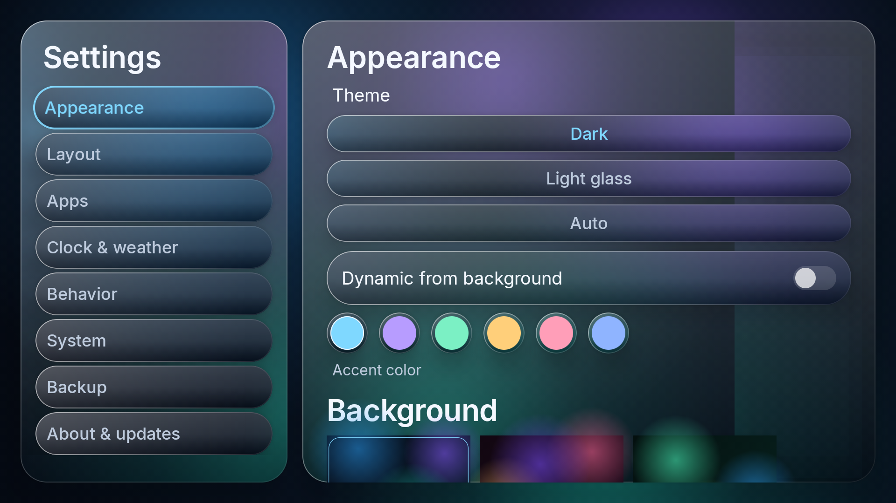
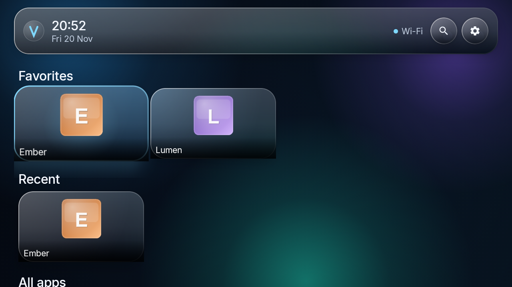

<p align="center">
  
</p>

<h1 align="center">Vitrum</h1>

<p align="center">
  Un launcher “liquid glass” per Fire TV, Android TV e Google TV.<br>
  Leggero, senza Google Play Services, pensato per il telecomando.
</p>

<p align="center">
  <a href="https://github.com/danyx67800/Vitrum/releases/latest">Download</a> ·
  <a href="#italiano">Italiano</a> ·
  <a href="#english">English</a>
</p>

---

## Italiano

**Vitrum** è un launcher indipendente per TV: pannelli di vetro smerigliato, sfondi procedurali animati e una home ordinata per Preferiti, Recenti, Tutte le app, righe personalizzate e scorciatoie di sistema. Tutto si usa con D-pad, OK, Back e Menu; il touch non serve.

### Screenshot

| Home 1080p | Impostazioni 1080p | Home 720p |
| --- | --- | --- |
|  |  |  |

Screenshot reali dall'emulatore Android TV (Google TV, API 31). Altre risoluzioni in [`docs/screenshots`](docs/screenshots).

### Funzionalità

- **Liquid glass**: blur reale su Android 12+ per i pannelli grandi, fallback con bitmap sfocata 1/8 in cache su API 22–30 e dispositivi low-RAM. Tinta 8–18%, bordo speculare, ombra morbida, angoli 24–32 dp.
- **Sfondi**: sei preset procedurali animati (Aurora, Laguna, Tramonto, Foresta, Neon, Ghiaccio), nessuna immagine di terzi; supporto a un'immagine personalizzata via URL HTTPS.
- **Home**: ora/data, rete Wi-Fi/Ethernet, meteo opzionale Open-Meteo, ricerca e impostazioni. Righe Preferiti, Recenti, Tutte le app, righe personalizzate e scorciatoie (Wi-Fi, Bluetooth, Display, Audio, Rete, Impostazioni, HDMI se disponibile).
- **Tutte le app**: griglia adattiva, ordinamento A–Z / recenti / manuale, filtro e tastiera su schermo completamente usabile col telecomando.
- **Menu contestuale**: apri, preferiti, sposta, aggiungi a riga, rinomina, nascondi, info, disinstalla con conferma.
- **Impostazioni complete**: aspetto, layout, overscan, app, orologio/meteo, comportamento, sistema, backup JSON, info, licenze e QR del repository.
- **OTA da GitHub Releases**: canale stabile/beta, controllo all'avvio/giornaliero/settimanale, solo Wi-Fi/Ethernet, ETag, note di rilascio, download con ripresa e velocità, SHA-256 e verifica della firma prima dell'installazione. Nessun token nel client.
- **Accessibilità e prestazioni**: focus sempre visibile, scala 80–130% più fattore automatico dall'altezza in dp, overscan 0–10%, contentDescription sulle tile, liste lazy con key stabili, cache icone in memoria, Baseline Profile di avvio.

### Compatibilità

- **minSdk 22** (Fire OS 5 / Fire TV Stick di prima generazione), compile/target SDK 36.
- Fire TV Stick Lite/HD/4K/4K Max, Fire TV Cube, Fire TV Edition, box e TV Android TV / Google TV.
- Nessuna dipendenza da Google Play Services, Firebase o analytics.
- Permessi: Internet, stato rete, installazione di pacchetti. La visibilità delle app usa `<queries>` per LEANBACK_LAUNCHER e LAUNCHER, senza `QUERY_ALL_PACKAGES`.

### Installazione su Fire TV

1. Scarica `Vitrum-vX.Y.Z.apk` dalla [release più recente](https://github.com/danyx67800/Vitrum/releases/latest).
2. Sul Fire TV, abilita **Impostazioni → My Fire TV → Opzioni sviluppatore → Installa app sconosciute** per l'app che userai (Downloader o un file manager).
3. Con **Downloader** apri l'URL della release e installa l'APK; oppure via ADB:
   ```bash
   adb connect <IP_DEL_FIRESTICK>:5555
   adb install -r Vitrum-vX.Y.Z.apk
   ```
4. Vitrum comparirà nell'elenco app e potrà essere aperto da lì. Il tasto Home resta collegato alla home Amazon: non è possibile sostituirla senza root o modifiche rischiose, e Vitrum non lo fa. Guida e comandi ADB sono mostrati nell'app a scopo informativo.

### Installazione su Android TV / Google TV

Installa l'APK via ADB o Downloader, apri Vitrum, poi **Impostazioni → Sistema → Guida launcher** e premi **Apri impostazioni Home**. Scegli Vitrum come launcher predefinito nella schermata di sistema. Il sistema mostrerà una conferma.

### Aggiornamenti OTA

Vitrum legge le release pubbliche del repository tramite l'API GitHub (ETag/If-None-Match per rispettare il rate limit). Un aggiornamento viene proposto solo se il tag `vX.Y.Z` è più recente della versione installata; il `versionCode` è calcolato come `major*10000 + minor*100 + patch`. Il download è consentito solo da host GitHub in HTTPS, riprende con `Range` e viene verificato con lo SHA-256 pubblicato nella release. L'APK deve avere la stessa firma dell'app installata. Tutte le release ufficiali sono firmate con la stessa keystore, custodita fuori dal repository.

### Privacy

Nessuna telemetria, nessun account, nessuna pubblicità. Le uniche richieste di rete sono:

- `api.github.com` e gli asset delle release GitHub, per gli aggiornamenti (solo su richiesta o secondo la frequenza scelta);
- `api.open-meteo.com` / `geocoding-api.open-meteo.com`, solo se il meteo è attivo;
- l'URL HTTPS scelto dall'utente, solo se imposta uno sfondo personalizzato.

I dati delle app non lasciano il dispositivo. Il backup delle impostazioni è un JSON locale esportato/importato dall'utente.

### Build da sorgente

Requisiti: JDK 17, Android SDK con platform 36, Gradle wrapper incluso.

```bash
./gradlew :app:assembleDebug
./gradlew :app:testDebugUnitTest :app:lintDebug
```

Release firmata in locale:

```bash
# keystore.properties nella root, mai committato:
# storeFile=C:/percorso/vitrum-release.jks
# storePassword=...
# keyAlias=vitrum
# keyPassword=...
./gradlew :app:assembleRelease -PversionName=1.0.1
```

La CI (`build.yml`) esegue test, lint e APK debug su ogni push/PR. `release.yml` parte dai tag `v*`, decodifica la keystore dai secret, produce `Vitrum-vX.Y.Z.apk` + `.sha256` e crea la release con note generate.

### Stato dei test

Vedi [Test e limiti](#test-e-limiti) in fondo.

### Licenza

MIT. Font Inter (SIL Open Font License) incluso; asset del marchio generati localmente.

---

## English

**Vitrum** is an independent TV launcher with frosted-glass panels, animated procedural backgrounds and a calm D-pad-first home for favorites, recent apps, all apps, custom rows and system shortcuts. Touch is optional; every screen is reachable with D-pad, OK, Back and Menu.

### Features

- **Liquid glass** with real blur on Android 12+ for large panels, plus a cached 1/8-scale blurred-bitmap fallback for API 22–30 and low-RAM devices. 8–18% tint, specular border, soft shadow, 24–32 dp corners.
- Six original procedural backgrounds plus an optional custom HTTPS image. No third-party artwork.
- Home rows: Favorites, Recent, All apps, user-defined rows and system shortcuts (Wi-Fi, Bluetooth, Display, Sound, Network, Settings, HDMI when available).
- Adaptive all-apps grid, A–Z/recent/manual sorting, on-screen D-pad keyboard and context menu (open, favorite, move, add to row, rename, hide, info, uninstall).
- Full settings: appearance, layout, overscan, apps, clock/weather, behavior, system shortcuts, JSON backup, about, licenses and repository QR.
- **OTA updates from GitHub Releases**: stable/beta channel, startup/daily/weekly checks, Wi-Fi/Ethernet only, ETag caching, release notes, resumable download with speed, SHA-256 and signature verification before install. No token ships in the app.
- **minSdk 22**, no Google Play Services, no telemetry. App visibility uses `<queries>`, not `QUERY_ALL_PACKAGES`.

### Install

Download the latest APK from [Releases](https://github.com/danyx67800/Vitrum/releases/latest). On Fire TV, allow **Install unknown apps** for Downloader or your file manager, then open the APK. Via ADB:

```bash
adb install -r Vitrum-vX.Y.Z.apk
```

On Android TV / Google TV, open Vitrum → **Settings → System → Launcher guide → Open Home settings** and select Vitrum as the default launcher.

The Fire TV Home button stays bound to Amazon's launcher. Vitrum does not use root or disable system apps; the in-app guide explains the supported options and shows advanced ADB commands for information only.

### Updates, privacy, build

OTA checks the public GitHub Releases API (ETag-aware), compares `vX.Y.Z` with the installed version (`versionCode = major*10000 + minor*100 + patch`), downloads only from GitHub over HTTPS, resumes with `Range`, verifies the published SHA-256 and requires the same signing certificate before installing. Official releases share one keystore kept outside the repository.

No analytics, accounts or ads. Network access is limited to GitHub (updates), Open-Meteo (weather, if enabled) and an optional user-supplied HTTPS background URL.

Build with JDK 17 and Android SDK 36:

```bash
./gradlew :app:assembleDebug
./gradlew :app:testDebugUnitTest :app:lintDebug
```

See `CONTRIBUTING.md` for contribution rules.

---

## Test e limiti / Testing and limitations

**Eseguito:** build debug, build release firmata e verificata con `apksigner`, 24 unit test JVM, `lintDebug` senza errori, onboarding e navigazione D-pad di base, schermate home/impostazioni su emulatore Google TV API 31 a 720p, 1080p e 1440p. Le prove OTA sono descritte qui sotto dopo la pubblicazione delle release.

**Non eseguito:** nessun Fire TV Stick, Fire TV Cube o TV Android TV fisica; nessun test del tasto Home Amazon; nessuna installazione reale da Downloader; nessun test su hardware a 1 GB di RAM. L'emulatore headless ha fermato l'override a 2560×1440, quindi non è stato possibile produrre uno screenshot nativo 4K. Il blur reale e il fallback sono stati visti su emulatore, non su GPU TV reali.

**Da provare a mano:** su un FireStick 4K Max e un dispositivo Android TV, verificare Home/LEANBACK launcher, focus con telecomando, overscan, prestazioni con 60+ app, download OTA e dialogo di installazione di sistema.

**Performed:** debug build, signed release verified with `apksigner`, 24 JVM unit tests, `lintDebug` with no errors, onboarding and basic D-pad navigation, home/settings screenshots on a Google TV API 31 emulator at 720p, 1080p and 1440p. OTA checks are documented below after the releases are published.

**Not performed:** no physical Fire TV Stick, Fire TV Cube or Android TV; no Amazon Home-button test; no real Downloader installation; no 1 GB-RAM hardware test. The headless emulator capped the display override at 2560×1440, so a native 4K screenshot could not be produced. Real blur and the bitmap fallback were seen only on the emulator.

**Manual checks still needed:** on a Fire TV Stick 4K Max and an Android TV device, verify Home/LEANBACK launching, D-pad focus, overscan, performance with 60+ apps, OTA download and the system install dialog.

## Licenza / License

MIT — see [LICENSE](LICENSE).
